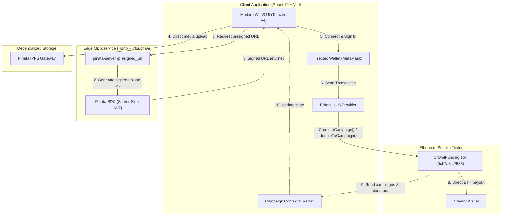

<p align="center">
  
</p>

<h1 align="center">🌱 CrowdSprout</h1>

<p align="center">
  <strong>Plant Web3 Ideas. Sprout Tomorrow.</strong>
</p>

<p align="center">
  A high-performance, decentralized crowdfunding dApp empowering creators, innovators, and open-source builders to raise capital transparently on Ethereum.
</p>

<p align="center">
  <a href="https://soliditylang.org/"></a>
  <a href="https://ethereum.org/"></a>
  <a href="https://react.dev/"></a>
  <a href="https://www.typescriptlang.org/"></a>
  <a href="https://vitejs.dev/"></a>
  <a href="https://tailwindcss.com/"></a>
  <a href="https://hardhat.org/"></a>
  <a href="https://pinata.cloud/"></a>
  <a href="https://hono.dev/"></a>
</p>

<p align="center">
  <a href="#-overview">Overview</a> •
  <a href="#-key-features">Key Features</a> •
  <a href="#-architecture--data-flow">Architecture</a> •
  <a href="#-tech-stack">Tech Stack</a> •
  <a href="#-smart-contract-details">Smart Contract</a> •
  <a href="#-project-structure">Structure</a> •
  <a href="#-getting-started">Getting Started</a> •
  <a href="#-security-architecture">Security</a> •
  <a href="#-roadmap">Roadmap</a>
</p>

---

## 🌟 Overview

**CrowdSprout** bridges the gap between visionary creators and global backers through trustless, decentralized crowdfunding. Traditional crowdfunding platforms impose steep intermediary fees, delayed payouts, and unilateral account freezes. 

CrowdSprout eliminates centralized bottlenecks:
- **Direct-to-Creator Settlement:** 100% of donated ETH lands straight in the creator's wallet at the moment of donation.
- **Permanent On-Chain Records:** Every pledge, backer address, and goal target is recorded on Ethereum smart contracts.
- **Decentralized Media Pinning:** Campaign pitch banners are pinned to IPFS through Pinata via secure pre-signed URLs.
- **Glassmorphic Cyber-Sprout Aesthetic:** Built with modern design tokens, interactive analytics, and responsive navigation for both mobile and desktop.

> [!NOTE]
> The primary smart contract is deployed and verified on **Ethereum Sepolia Testnet** at [`0xb7a8C4149e024ef4C957A901a006621aE0607585`](https://sepolia.etherscan.io/address/0xb7a8C4149e024ef4C957A901a006621aE0607585).

---

## ✨ Key Features

<table>
  <tr>
    <td width="50%">
      <h3>🌱 Decentralized Campaign Creation</h3>
      Launch campaigns with target funding goals, future deadlines, and rich storytelling. Campaign banners are uploaded directly to IPFS without exposing API secrets.
    </td>
    <td width="50%">
      <h3>⚡ Instant Trustless Donations</h3>
      Backers pledge ETH directly using MetaMask or any EIP-1193 wallet. Smart contracts transfer funds immediately to the campaign owner's wallet with zero platform custody risk.
    </td>
  </tr>
  <tr>
    <td width="50%">
      <h3>📊 Real-Time Ecosystem Metrics</h3>
      Live aggregate metrics bar tracking total sprouts planted, currently active campaigns, total ETH raised across the platform, and aggregate funding goals.
    </td>
    <td width="50%">
      <h3>🔍 Transparent Backer Ledger</h3>
      View complete donor audit trails per campaign—including contributor wallet addresses, timestamps, individual donation amounts, and funding milestones.
    </td>
  </tr>
  <tr>
    <td width="50%">
      <h3>🛡️ Secure Pre-Signed IPFS Uploads</h3>
      Cloudflare Workers / Hono edge microservice signs temporary upload URLs, ensuring your master <code>PINATA_JWT</code> is never leaked to the client browser.
    </td>
    <td width="50%">
      <h3>👤 Creator Profile & Portfolio</h3>
      Dedicated profile dashboard aggregating all campaigns created by the connected wallet, total funds raised, and real-time funding statuses.
    </td>
  </tr>
</table>

---

## 🏗️ Architecture & Data Flow



---

## 💻 Tech Stack

### Frontend Client
| Technology | Version | Purpose |
| :--- | :--- | :--- |
| **React** | `19.2.8` | Declarative UI components & state transitions |
| **TypeScript** | `6.0.2` | End-to-end static typing and interface contracts |
| **Vite** | `8.3.0` | Next-generation lightning-fast frontend tooling |
| **Tailwind CSS** | `4.3.3` | Fluid responsive design with custom theme tokens |
| **Ethers.js** | `6.17.0` | Ethereum RPC communication, contract interactions & wallet hooks |
| **Redux Toolkit** | `2.13.0` | Global state management for user sessions & cached data |
| **React Router** | `7.18.4` | Seamless single-page client routing |
| **Pinata SDK** | `2.5.6` | Decentralized file upload & IPFS media handling |
| **React Icons** | `5.7.0` | Feather & Lucide icon sets |

### Edge Backend (`pinata-server`)
| Technology | Purpose |
| :--- | :--- |
| **Hono** | Ultrafast, lightweight edge web framework |
| **Cloudflare Workers** | Globally distributed serverless execution |
| **Pinata SDK** | Generates 60-second presigned upload URLs |
| **Wrangler** | Local development CLI & deployment pipeline |

### Smart Contracts & Tooling (`web3`)
| Technology | Purpose |
| :--- | :--- |
| **Solidity `^0.8.34`** | Smart contract development with native overflow checks |
| **Hardhat 3** | Compilation, local blockchain node, and contract scripting |
| **Hardhat Ignition** | Declarative, reproducible deployment modules |
| **Foundry / Mocha** | Comprehensive unit & integration testing suite |
| **Hardhat Verify** | Automated contract verification on Sepolia Etherscan |

---

## 📜 Smart Contract Details

### Contract Architecture (`CrowdFunding.sol`)

The `CrowdFunding` contract manages campaigns as on-chain structs stored in a public mapping:

```solidity
struct Campaign {
    address owner;          // Creator wallet receiving donations
    string title;           // Campaign title
    string description;     // Pitch and project vision
    uint256 target;         // Funding goal in wei
    uint256 deadline;       // Unix timestamp deadline
    uint256 amountCollected;// Total wei raised so far
    string image;           // IPFS CID or gateway URL
    address[] donators;     // Array of contributor addresses
    uint256[] donations;    // Array of individual donation amounts
}
```

### Core Interface Functions

| Function | Modifiers | Description |
| :--- | :--- | :--- |
| `createCampaign(address, string, string, uint256, uint256, string)` | `public returns (uint256)` | Plants a new campaign; validates deadline is in the future. |
| `donateToCampaign(uint256)` | `public payable` | Transfers pledged ETH directly to `campaign.owner` and tracks donation ledger. |
| `getDonators(uint256)` | `public view returns (address[], uint256[])` | Fetches arrays of donator addresses and corresponding amounts for a campaign. |
| `getCampaigns()` | `public view returns (Campaign[])` | Returns all campaigns on-chain for the dashboard view. |

> [!TIP]
> **Verified Contract on Sepolia:**  
> Inspect the live code and transactions on [Etherscan Sepolia: 0xb7a8C4149e024ef4C957A901a006621aE0607585](https://sepolia.etherscan.io/address/0xb7a8C4149e024ef4C957A901a006621aE0607585).

---

## 📂 Project Structure

```text
crowd-sprout/
├── assets/                       # Brand assets & logos for documentation
│   └── logo.jpg
├── client/                       # React 19 + TypeScript + Vite + Tailwind CSS v4
│   ├── src/
│   │   ├── assets/               # Logos, hero images, and vector icons
│   │   ├── components/           # Navbar, Sidebar, HeroBanner, StatsBar, FundCard
│   │   ├── constants/            # Contract ABI & navigation links
│   │   ├── context/              # Web3 provider & CampaignContext (Ethers v6)
│   │   ├── pages/                # Home, CreateCampaign, CampaignDetails, Profile
│   │   ├── store/                # Redux store slices
│   │   ├── utils/                # ETH formatters, error parsers, IPFS helpers
│   │   ├── App.tsx               # Main layout and route definitions
│   │   └── main.tsx              # Application entry point
│   ├── .env.example              # Client environment template
│   └── package.json
├── pinata-server/                # Cloudflare Workers / Hono presigned upload service
│   ├── src/
│   │   └── index.ts              # Hono app with /presigned_url endpoint
│   ├── .dev.vars.example         # Pinata secret template
│   ├── wrangler.jsonc            # Cloudflare Worker configuration
│   └── package.json
├── web3/                         # Hardhat 3 Ethereum development environment
│   ├── contracts/
│   │   └── CrowdFunding.sol      # Main crowdfunding smart contract
│   ├── ignition/modules/
│   │   └── CrowdFunding.ts       # Hardhat Ignition deployment module
│   ├── test/                     # Solidity & TypeScript mocha test suites
│   ├── hardhat.config.ts         # Hardhat 3 & network configuration
│   ├── .env.example              # RPC & deployer private key template
│   └── package.json
└── README.md
```

---

## 🚀 Getting Started

### Prerequisites

Ensure you have the following installed:
- [Node.js](https://nodejs.org/) `>= 18.0.0`
- [pnpm](https://pnpm.io/) or [npm](https://www.npmjs.com/)
- A Web3 Wallet (e.g. [MetaMask](https://metamask.io/)) with Sepolia Testnet ETH (from [Sepolia Faucet](https://cloud.google.com/application/web3/faucet/ethereum/sepolia))
- A free [Pinata Account](https://pinata.cloud/) for IPFS API keys

---

### Step 1: Clone the Repository

```bash
git clone https://github.com/MikiZenebe/Crowd-Sprout.git
cd crowd-sprout
```

---

### Step 2: Configure Environment Variables

#### 1. Client App (`client/.env.local`)
Copy the example configuration:
```bash
cp client/.env.example client/.env.local
```
Fill in the variables:
```env
VITE_CONTRACT_ADDRESS=0xb7a8C4149e024ef4C957A901a006621aE0607585
VITE_GATEWAY_URL=your-gateway-name.mypinata.cloud
VITE_SERVER_URL=http://localhost:8787
VITE_ETHERSCAN_API_KEY=your_etherscan_api_key
```

#### 2. Pinata Edge Worker (`pinata-server/.dev.vars`)
```bash
cp pinata-server/.dev.vars.example pinata-server/.dev.vars
```
Add your Pinata credentials:
```env
PINATA_JWT=your_pinata_jwt_here
GATEWAY_URL=your-gateway-name.mypinata.cloud
```

#### 3. Smart Contracts (`web3/.env`) *(Optional if using deployed contract)*
```bash
cp web3/.env.example web3/.env
```
Configure your Sepolia RPC and deployer account:
```env
SEPOLIA_RPC_URL=https://eth-sepolia.g.alchemy.com/v2/your_alchemy_key
SEPOLIA_PRIVATE_KEY=your_private_key_without_0x
ETHERSCAN_API_KEY=your_etherscan_api_key
```

---

### Step 3: Run the Services

#### 🌿 Terminal A: Start the Pinata Presigned URL Server
```bash
cd pinata-server
npm install
npm run dev
# Server runs on http://localhost:8787
```

#### 💻 Terminal B: Start the Frontend Client
```bash
cd client
npm install
npm run dev
# Application starts at http://localhost:5173
```

#### ⚙️ Terminal C: Smart Contracts (Compile & Test)
```bash
cd web3
npm install
npx hardhat compile
npx hardhat test
```

To deploy a new instance to Sepolia using Hardhat Ignition:
```bash
npx hardhat ignition deploy --network sepolia ignition/modules/CrowdFunding.ts
```

---

## 🔒 Security Architecture

| Security Layer | Implementation |
| :--- | :--- |
| **Zero Private Key Exposure** | Client applications never touch private keys; transactions are signed by users through their wallet provider (MetaMask). |
| **Decoupled IPFS Authorization** | The Pinata master JWT is isolated inside the edge worker (`pinata-server`). The client only receives single-use 60-second presigned URLs. |
| **Direct Fund Forwarding** | Funds are forwarded via `.call{value: amount}("")` directly to the campaign creator, preventing contract lockups or central honeypots. |
| **Input Validation** | Solidity `require()` guards enforce valid target amounts and strictly future deadline timestamps. |

---

## 🗺️ Roadmap

- [x] Core CrowdFunding Solidity Smart Contract on Sepolia
- [x] Responsive React 19 + Tailwind CSS v4 Dashboard
- [x] Secure IPFS upload pipeline with Pinata Presigned URLs
- [x] Real-time platform metrics and campaign search/filter
- [x] Interactive backer donation flow with custom amounts
- [ ] **Milestone-Based Escrow Release:** Unlock funds in tranches as creators achieve roadmap milestones
- [ ] **Multi-Token Contributions:** Support for ERC-20 tokens (USDC, USDT, DAI)
- [ ] **Backer Governance (DAO):** Vote on campaign milestone verifications before subsequent payouts
- [ ] **NFT Donor Badges:** Commemorative on-chain badges for early backers
- [ ] **Layer 2 Deployment:** Expansion to Arbitrum, Base, or Optimism for ultra-low gas fees

---

## 🤝 Contributing

Contributions are what make the open-source community such an inspiring place to learn, create, and build. Any contributions you make are **greatly appreciated**.

1. Fork the Project
2. Create your Feature Branch (`git checkout -b feature/AmazingSprout`)
3. Commit your Changes (`git commit -m 'feat: Add an AmazingSprout feature'`)
4. Push to the Branch (`git push origin feature/AmazingSprout`)
5. Open a Pull Request

---

## 📄 License

Distributed under the MIT License. See `LICENSE` for more information.

---

<p align="center">
  Crafted with ❤️ by <a href="https://github.com/MikiZenebe"><strong>Miki Zenebe</strong></a>
</p>

<p align="center">
  <a href="#-crowdsprout-">Back to Top ↑</a>
</p>
